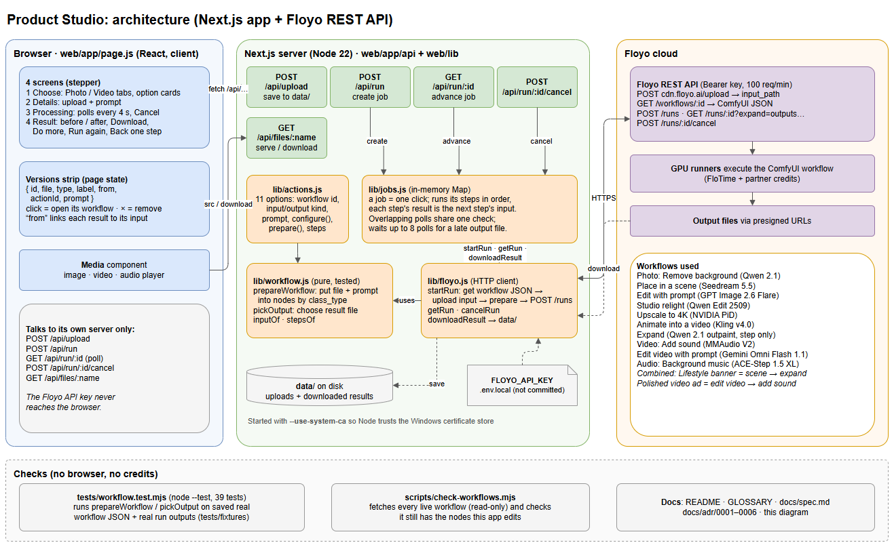

# Product Studio

Product Studio is a web app that turns product photos and videos into marketing content using AI workflows on [Floyo](https://www.floyo.ai). You upload a photo or video, pick what you want, and get the result with a before/after view and a download button. You can keep working on any result without starting over.

- **Photos:** remove the background, place the product in a scene you describe, edit it with a prompt, make a lifestyle banner, relight it, upscale it to 4K, or animate it into a video.
- **Videos:** edit a clip with a prompt, add matching sound, or do both in one click.
- **Music:** generate a 30-second background track for your ads (no upload needed).

Each option runs a ready-made Floyo workflow (a ComfyUI graph running on Floyo's GPUs) through the Floyo REST API.



## Tech stack

| Layer | Technology |
|---|---|
| Frontend | React 19 (one client page, no UI library), plain CSS |
| Backend | Next.js 15 API routes (App Router) on Node.js 22 |
| AI | Floyo REST API: workflows, CDN uploads, runs, presigned outputs |
| Storage | Local `web/data/` folder for uploads and results; job state in memory |
| Tests | Node.js built-in test runner (`node --test`) on saved real Floyo workflows and outputs |
| Docs | Spec, ADRs, glossary, draw.io diagrams |

No database, no extra runtime dependencies: just `next`, `react` and `react-dom`.

## How it works

1. The browser only talks to this app's own API (`/api/upload`, `/api/run`, `/api/run/:id`, `/api/run/:id/cancel`, `/api/files/:name`). The Floyo API key stays on the server.
2. Starting an option creates a **job**. For each step, the server fetches the workflow's ComfyUI JSON, uploads the input to Floyo's CDN, puts the file and prompt into the right nodes (found by node type), and starts a Floyo run.
3. The browser polls every 4 seconds. Each poll checks the Floyo run; when it finishes, the server downloads the result and, for combined options, starts the next step with that result as input.
4. Results become **versions** linked to the version they came from. That gives you before/after, "Back one step", re-running with the same prompt, and removing versions.

The step-by-step flow is in [docs/flow.png](docs/flow.png). Both diagrams are drawn in [docs/architecture.drawio](docs/architecture.drawio) (open it in [diagrams.net](https://app.diagrams.net); one page each).

## Run it locally

You need:
- **Node.js 22.15 or later**
- **A Floyo account and API key** (in Floyo: Team Settings > Floyo API). Running options uses Floyo credits (see the table below).

```bash
git clone <this repo>
cd <repo>/web
npm install

# create web/.env.local with your key
cp .env.example .env.local        # Windows: copy .env.example .env.local
# then edit .env.local:  FLOYO_API_KEY=your_key_here

npm run dev                       # open http://localhost:3000
```

For a production build: `npm run build`, then `npm start`.

`npm run dev` and `npm start` run Node with `--use-system-ca`, so it trusts your operating system's certificates. That is needed on networks that inspect HTTPS traffic.

### Checks

```bash
npm test                  # 39 tests, offline, no Floyo credits used
npm run check:workflows   # checks that each live Floyo workflow still has the nodes the app edits (read-only, needs the key)
```

## Options

| Option | Floyo workflow | Typical time | Cost |
|---|---|---|---|
| Remove background | Qwen Image 2.1 for Background Removal | ~1 min | FloTime |
| Place in a scene | Seedream 5.5 for Image Editing | ~30 s | ~$0.03 partner credits |
| Edit with prompt | GPT Image 2.6 Flare Edit | ~30 s | ~$0.05 partner credits |
| Lifestyle banner (2 workflows) | Place in a scene, then Expand to banner | ~1.5 min | both steps' costs |
| Studio relight | Qwen Image Edit 2509 · Relight | 2 to 15 min (slow when the model is cold) | FloTime |
| Upscale to 4K | NVIDIA PiD for 4K Image Upscale | ~1 to 2 min | FloTime |
| Animate into a video | Kling v4.0 · Image to Video (5 s, 1080p) | ~9 min | ~$1.18 partner credits + FloTime |
| Add sound to video | MMAudio V2 (sound as long as the clip, up to 30 s) | ~30 s | ~$0.005 partner credits |
| Edit video with prompt | Gemini Omni Flash 1.1 for Video Edit (720p result) | ~1.5 min | ~$0.50 partner credits |
| Polished video ad (2 workflows) | Edit video with prompt, then Add sound to video | ~2.5 min | both steps' costs |
| Background music (no upload) | ACE-Step 1.5 XL - Text to Music (30 s instrumental MP3) | ~1 min | FloTime |

Expand to banner (Qwen Image 2.1 Outpainting) runs only as step 2 of Lifestyle banner. Its 12B prompt-enhancer model is switched off, which cuts the step from 5+ minutes to about 1.

## Project layout

```
web/
  app/page.js                 the UI: Choose, Details, Processing, Result, versions
  app/api/                    upload, run, run status, cancel, files
  lib/actions.js              the options: workflow id and how each edits its workflow
  lib/workflow.js             prepareWorkflow and pickOutput (pure, tested)
  lib/jobs.js                 one click = one job; runs combined options step by step
  lib/floyo.js                Floyo API calls
  tests/                      tests and fixtures saved from real Floyo runs
  scripts/check-workflows.mjs live workflow check
docs/
  spec.md                     what the app does and why (user stories)
  adr/                        decisions and the reasons behind them
  architecture.drawio         architecture + flow diagrams (draw.io)
  architecture.png, flow.png  the same diagrams as images
  floyo-workflows.md          catalog of Floyo workflows, grouped by task
GLOSSARY.md                   the words this project uses
```

## Limitations

This is a single-user local app. Jobs are kept in memory, so a server restart loses runs in progress. Files are stored on local disk and never cleaned up, and there is no login. For production it would need a database or queue for jobs, object storage for files, and authentication.

Built with [Claude Code](https://claude.com/claude-code).
